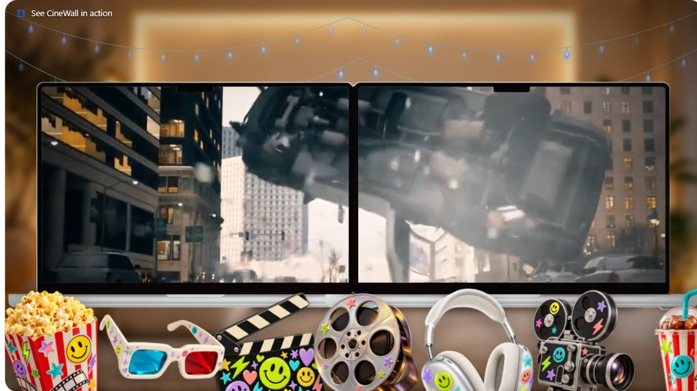
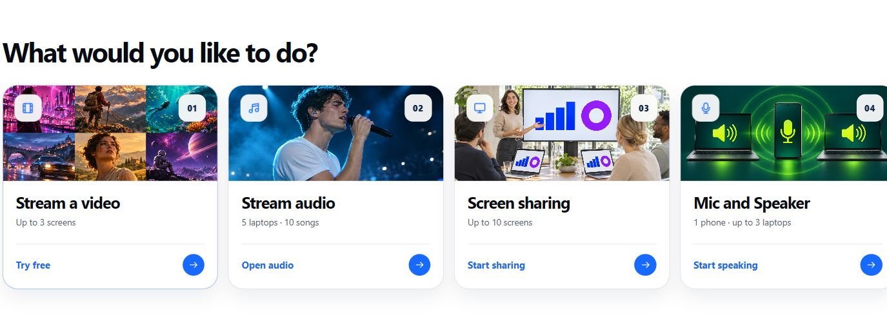

<p align="center">
  
</p>

# CineWall

**Turn the laptops you already own into a mini theatre.** CineWall splits one video across nearby laptop screens and lets you control playback from one browser dashboard. You can also play a shared music queue, mirror a screen, or use a phone as a microphone.

[Try CineWall](https://watch.aitoyz.in/) · [Watch the setup tutorial](https://www.youtube.com/watch?v=nKjiv6_XSN4) · [Report a bug or suggest a feature](https://github.com/AryanETH/Cine-wall/issues)

[](https://watch.aitoyz.in/#demo)

## What you can do

| Mode | What it does | Devices |
| --- | --- | --- |
| [Video wall](https://watch.aitoyz.in/admin.html?mode=video) | Split one movie across laptops. Play, pause, and seek together. | Up to 3 laptop or PC screens |
| [Audio room](https://watch.aitoyz.in/admin.html?mode=audio) | Queue up to 10 songs. Play full sound on each laptop or spread the stereo channels with 3D Sound. | Up to 5 laptops or PCs |
| [Screen sharing](https://watch.aitoyz.in/share.html) | Mirror a tab, window, or desktop. Optional room calls support up to 4 devices. | Up to 10 laptop or PC receivers, plus the presenter |
| [Mic and Speaker](https://watch.aitoyz.in/mic.html) | Send a phone’s mic to laptop speakers. Includes a teleprompter and voice recorder. | 1 phone and up to 3 laptop speakers |

<details>
  <summary>See the four modes on the homepage</summary>
  
</details>

## Try it in three steps

1. On the source laptop, open [CineWall](https://watch.aitoyz.in/), sign in, and choose a mode. Verify your email if prompted.
2. Connect the devices to the same Wi-Fi or hotspot. Open a different numbered link on each laptop. For Mic and Speaker, open the phone link on your phone.
3. Choose a file and wait for the selected screens to be ready before pressing **Play**. In Screen sharing, click **Share screen** and pick what to share.

Only the source laptop needs the original file. Keep its dashboard open while sharing. Start with an **H.264/AAC MP4** if you’re testing the video wall. Laptop bezels stay visible, and playback quality depends on the devices and network.

## Recent updates

- **One room ID across modes.** Switching tools from an existing workspace keeps its room ID. Copy the links for the mode you’re using.
- **Playback sync improvements.** Video and audio have more time to start together, and the room can pause and resume together when a screen buffers.
- **Hands-free video controls.** Turn on optional webcam gestures in the video player for play, pause, volume, and seeking. First use includes a short practice. Camera frames are processed locally.
- **Verified accounts and a profile menu.** Workspace access requires a verified email. The homepage has a profile menu and a light/dark toggle.
- **Refreshed dashboards and landing page.** Video, Audio, Screen sharing, and Mic and Speaker share a consistent layout. The homepage demo shows one movie playing across two laptops.

## Run locally

Use **Node.js 20.19 or newer**. The optional YouTube downloader has [additional requirements](docs/youtube-downloads.md).

```sh
git clone https://github.com/AryanETH/Cine-wall.git
cd Cine-wall
npm ci
npm start
```

Open [localhost:4173](http://localhost:4173) on the host laptop. For other devices, use the links copied from the dashboard. Phone microphone access needs trusted HTTPS. Firebase sign-in requires internet access and an authorized hostname.

| Need help with | Start here |
| --- | --- |
| Device setup, formats, or troubleshooting | [User guide](docs/user-guide.md) |
| Hosting or account setup | [Hosting guide](HOSTING.md) · [Firebase setup](FIREBASE.md) |
| Room links and switching modes | [Rooms](ROOMS.md) · [Mode switching](MODE_SWITCHING.md) |
| Advertising system setup | [Advertising guide](ADVERTISING.md) |
| Sharing CineWall with a community | [Demo and outreach guide](docs/share-cinewall.md) |

## Contribute

Try a mode and [tell us how it went](https://github.com/AryanETH/Cine-wall/issues). If something breaks, include the mode, browser, operating system, number of devices, and steps to reproduce. For playback issues, include the file’s codecs if you know them.

Run `npm run check` and `npm test` before opening a pull request. Some integration tests start a temporary local server.

Built by [Aryan Patil](https://www.linkedin.com/in/aryan686/). CineWall does not yet specify a project-wide license. Bundled components retain their own licenses, including [PDF.js](public/vendor/pdfjs/LICENSE) and the [Anta font](public/fonts/OFL.txt).
